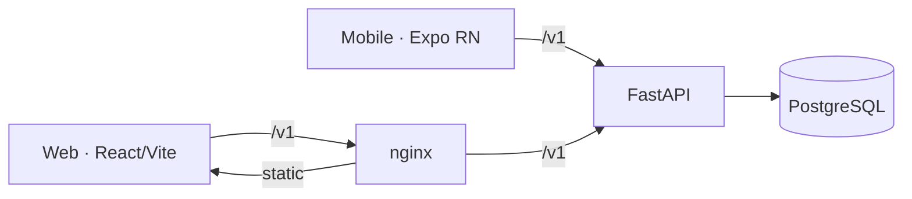

# Architecture

Sthira is a monorepo with three deployables — a FastAPI service and two clients —
sharing one versioned HTTP contract.



## Backend: a modular monolith

The API is a single deployable organized by domain. Each request flows through a
fixed set of layers, and each layer has one job:

```
HTTP → router (app/api/v1)         # validation, auth dependency, status codes
     → service (app/modules/*)     # business rules, transactions, orchestration
     → repository (app/modules/*)  # data access over SQLAlchemy
     → model (app/models)          # ORM tables
```

Domain modules under `apps/api/app/modules/`:

| Module | Responsibility |
|---|---|
| `accounts` | Financial accounts and their balances |
| `transactions` | The ledger — money in/out, with idempotent creation |
| `transfers` | Atomic account-to-account transfers (paired ledger entries) |
| `budgets` | Per-month budget lines |
| `goals` | Savings goals and progress |

Routers stay thin; anything with a decision in it lives in a service. Services own
the database transaction boundary, so a single request is one atomic unit of work.

## Data & money

- **Money** is stored as `Numeric(19,4)` and handled as `Decimal` end to end — no
  floats in the money path.
- **Identifiers** are UUID primary keys; foreign keys are indexed.
- **Timestamps** are timezone-aware (UTC).
- **Soft delete + audit** — financial mutations are soft-deleted and recorded in an
  append-only audit log, so history is reconstructable.

### Ledger integrity

Balance updates take a `SELECT … FOR UPDATE` row lock on the account before the
read-modify-write, so concurrent writes to the same account cannot lose updates.
A concurrency integration test asserts this (and fails if the lock is removed).
Transaction creation accepts an `Idempotency-Key`; a replayed request returns the
original result and writes once.

## Auth & security

- Server-side sessions via a signed session cookie; passwords hashed with bcrypt.
- CSRF token required on authenticated mutating requests.
- Login throttling per email (in-memory, or Redis when `REDIS_URL` is set).
- Role-based access control (`require_role` / `require_admin`) gates an admin/audit
  surface, additive to per-user ownership scoping.
- Security response headers (CSP, HSTS, X-Frame-Options, …) at both the app and nginx.

## Cross-cutting concerns

- **Request IDs** — every request carries an `X-Request-Id` (generated or echoed).
- **Structured logging** — JSON logs with per-request context and latency.
- **Metrics & tracing** — Prometheus `/metrics`; opt-in OpenTelemetry via
  `OTEL_EXPORTER_OTLP_ENDPOINT`.
- **Errors** — a single RFC 7807 problem+JSON shape across all endpoints.
- **Health** — `/v1/health/live` (liveness) and `/v1/health/ready` (checks the DB).

## Clients & the typed contract

The web and mobile clients generate their TypeScript types from the server's
OpenAPI schema (`apps/web/src/lib/api/openapi.json`), which is the single source of
truth. CI fails if the committed schema drifts from the code, so the clients can
never silently diverge from the API.

## Migrations

Schema changes are Alembic migrations under `apps/api/alembic`. They run as an
explicit release step (a Helm pre-upgrade Job, or `alembic upgrade head` by hand) —
never on application boot, so replicas start without racing each other.
